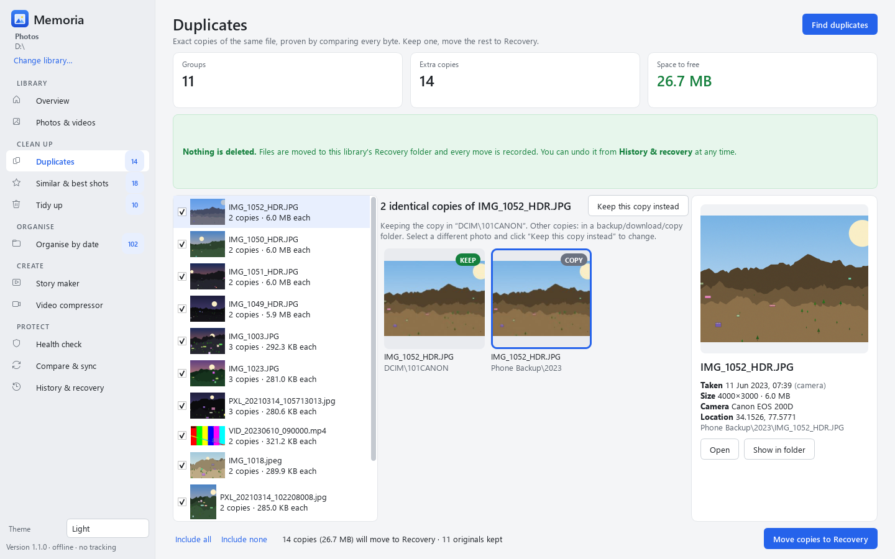
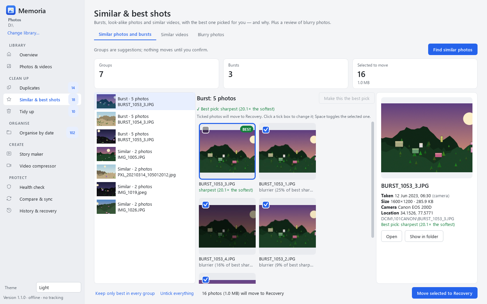
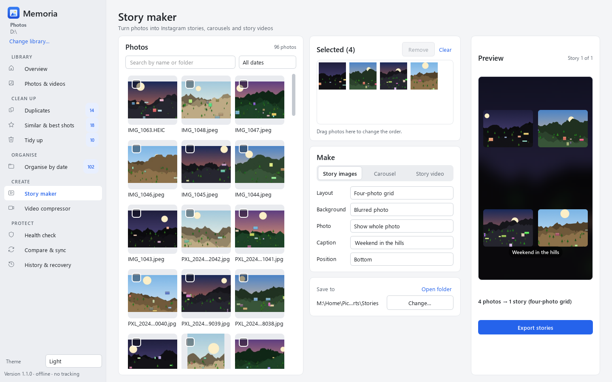
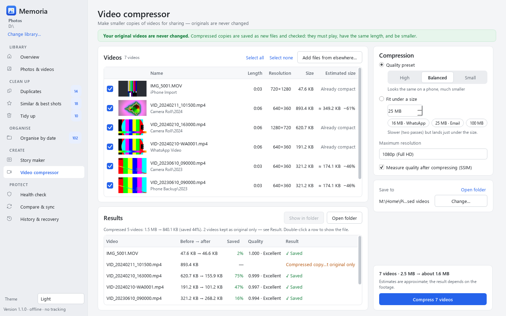
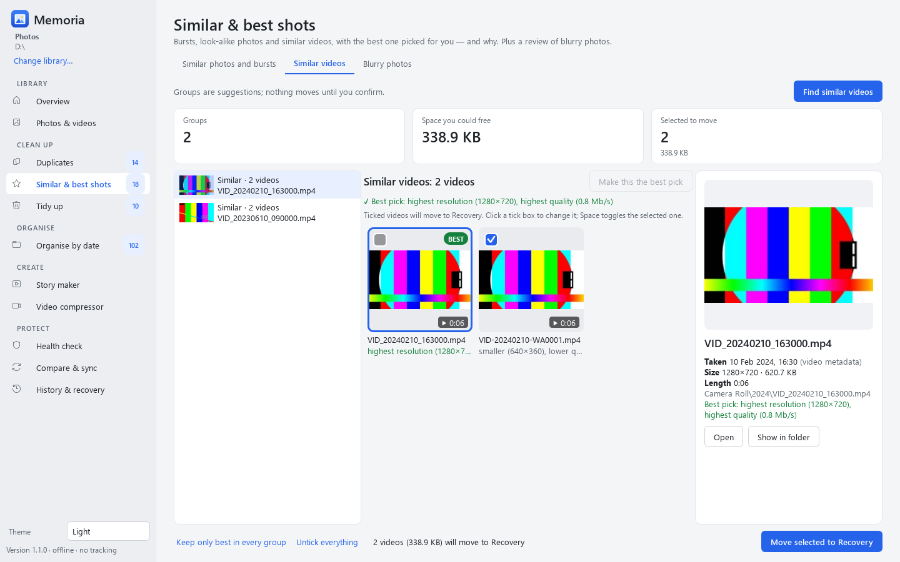
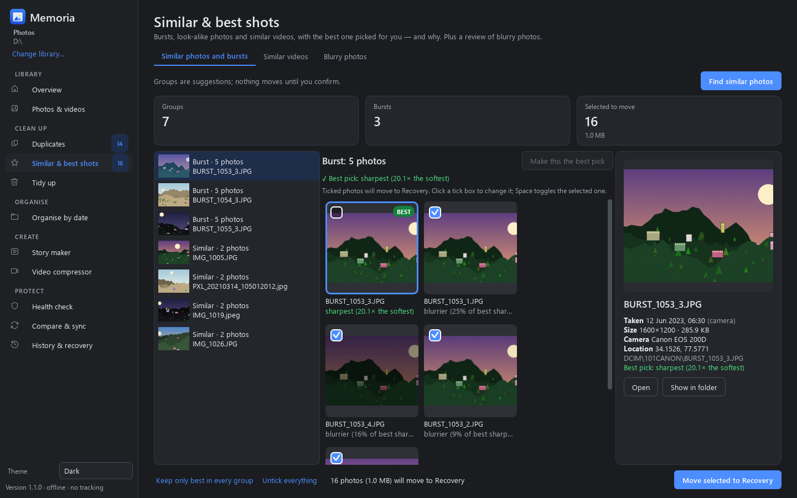
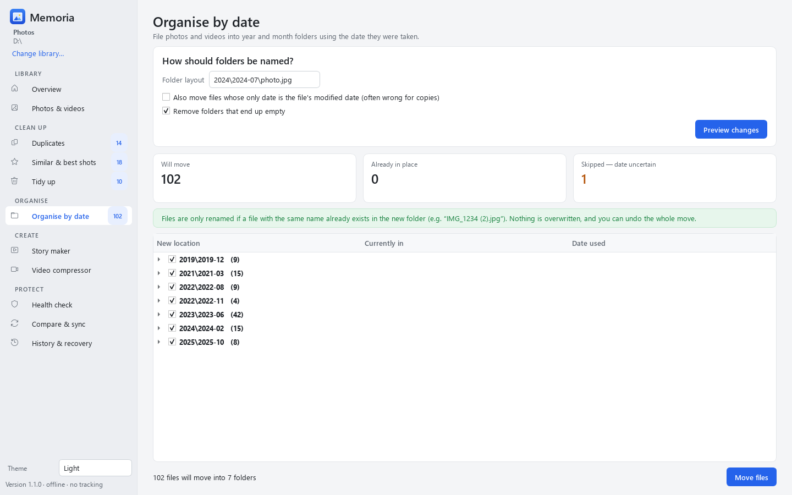
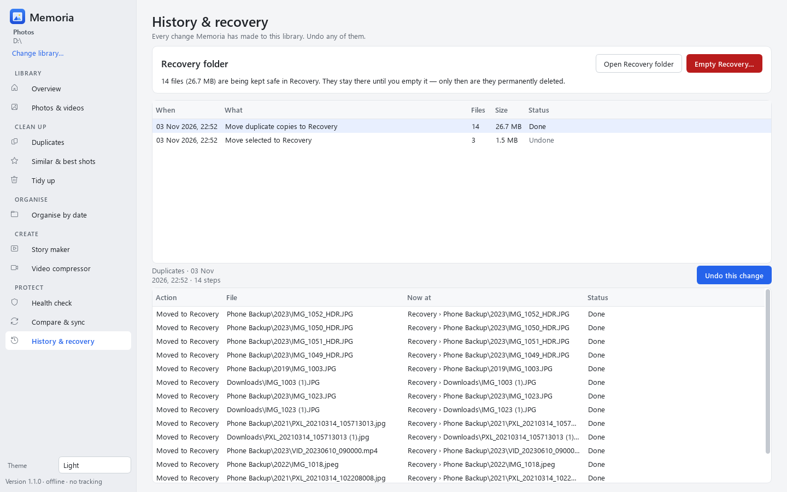

# Memoria — photo & video manager

A private, offline photo and video manager for Windows, built to be easy to trust.

Memoria looks after a personal photo library:
- finds exact duplicates and look-alike shots, and picks the best photo of a burst;
- clears junk files and files photos into date folders;
- detects silent file damage and compares the library with a backup;
- makes Instagram stories and story videos, and smaller copies of videos for sharing.

Every change is shown before it happens, explained, and undoable. **Nothing is ever deleted** unless you
explicitly empty the Recovery folder.


| 📘 [Features guide](docs/features.html) | 🎨 [Design document](docs/design.html) | 🛠️ [Technical document](docs/technical.html) | ✅ [Quality report](docs/report.html) |
|---|---|---|---|

The documents are HTML files in [`docs/`](docs/index.html). Open them locally in a browser (GitHub shows HTML source, not
the rendered page).

---

## Contents

- [Highlights](#highlights)
- [Quick start](#quick-start)
- [The tools](#the-tools)
- [Why you can trust it](#why-you-can-trust-it)
- [Screenshots](#screenshots)
- [How it works](#how-it-works)
- [Repository layout](#repository-layout)
- [Testing & quality reports](#testing--quality-reports)
- [Building a standalone app](#building-a-standalone-app)
- [Performance](#performance)
- [Troubleshooting](#troubleshooting)
- [Roadmap](#roadmap)
- [Licence](#licence)

## Highlights

- **11 focused pages** replace the 20 commands of the old command-line tool, plus **Check everything**: one read-only
  pass that runs every finder and puts count badges in the sidebar.
- **Find → Review → Confirm → Apply → Undo** for every change, with plain-language reasons for every suggestion.
- **Exact duplicates are proven**, not guessed: files are compared by full-content hash (xxh3-128), and the kept copy is
  verified before anything moves.
- **Similar videos**: finds compressed, resized or trimmed copies by comparing frames, and keeps the best copy.
- **Batch actions** in Photos & videos: select many items, then move to Recovery, copy to a folder (verified), move
  within the library, compress, or send to the Story maker. All undoable.
- **Light, dark or Match Windows** themes, keyboard shortcuts, a built-in viewer, and thumbnail zoom.
- **Progress everywhere**: percentage, elapsed time and time left for every task, with Cancel (Esc).
- **Best-shot picker** for bursts and WhatsApp-style copies. It scores sharpness, exposure, faces and resolution, and
  shows the reasoning (e.g. "sharpest (20× the softest)").
- **Story maker**:
  - 1080×1920 stories in six layouts;
  - 4:5 or square carousels, including a seamless panorama split;
  - story videos with Ken Burns motion, crossfades and music.
- **Video compressor**:
  - quality presets, or a target size such as 16 MB for WhatsApp;
  - every copy must play, keep the same length and be smaller;
  - an SSIM quality score is reported.
- **Health check** fingerprints every file and flags silent damage, such as bit rot or bad copies.
- **Fast**: about 180 photos/s on first index; rescans in milliseconds; 100,000-photo similarity search in about 4 s.
- **Tested** against a generated library with known answers: 88 automated tests, including an end-to-end UI test in both
  themes.

## Quick start

Requirements: Windows 10/11 and Python 3.11+ (3.12 recommended).

```powershell
git clone https://github.com/rishabhjain9196/memoria-photo-manager.git
cd memoria-photo-manager
.\run.ps1                    # first run creates .venv and installs dependencies, then starts the app
.\run.ps1 "D:\Photos"        # open a specific library
```

Other ways to start:

```powershell
.\.venv\Scripts\pythonw.exe Memoria.pyw          # no console window
.\.venv\Scripts\python -m memoria "D:\Photos"    # module entry point
pip install -e .[dev]; memoria                   # installs the 'memoria' GUI command (pyproject.toml)
```

No library handy? On the welcome screen choose **Try it on a sample library**. It generates a realistic library in
`%LOCALAPPDATA%\Memoria\Sample Library` with duplicates, bursts, junk, a damaged file and videos.

## The tools

| Page | What it does | What it changes |
|---|---|---|
| **Overview** | Totals, years covered, safety status, and what each tool would do for this library. | Nothing |
| **Photos & videos** | Timeline (year → month), search, filters, zoom, viewer and a large preview. The preview shows the date and where it came from, camera, GPS and problems. **Batch actions** on a selection. | Nothing, unless you run a batch action |
| **Duplicates** | Byte-identical copies, grouped. Memoria explains which copy it keeps; you can choose another or exclude a group. | Moves copies to Recovery |
| **Similar & best shots** | Bursts, retakes and resized copies, with an explained best pick. The *Similar videos* tab finds re-encoded and trimmed copies. A *Blurry photos* tab has three sensitivities, and nothing is pre-ticked. | Moves ticked items to Recovery |
| **Tidy up** | Thumbs.db, desktop.ini, .DS_Store, `._` files, partial downloads, empty files and folders. Unreadable media and stray documents start unticked. | Moves files to Recovery; removes empty folders (undo recreates them) |
| **Organise by date** | Moves files into `2024\2024-07`-style folders using the camera date, then a date in the file name. Files dated only by modified time are skipped unless you opt in. | Moves files inside the library |
| **Story maker** | Instagram stories, carousels and story videos with a live preview. | Writes new files to an output folder |
| **Video compressor** | Smaller copies of videos for sharing, using presets or a target size, with verification and a quality score. | Writes new files to an output folder |
| **Health check** | Records a fingerprint of every file, then flags *possibly damaged*, *can't be opened* and *missing* files on later checks. | Nothing (catalogue only) |
| **Compare & sync** | Compares the library with a backup by content, so renamed copies still match. Copies what's missing in either direction. | Writes verified copies |
| **History & recovery** | Every change with each step; Undo; open or empty Recovery. | Undo / Empty Recovery (the only permanent deletion) |

The [Features guide](docs/features.html) explains every option.

## Why you can trust it

| Promise | How it is enforced |
|---|---|
| Looking never changes anything | Scanning, analysis, comparison and health checks only read files. Memoria writes only to a hidden `.memoria` folder in the library. |
| You see every change first | One shared confirmation flow states exactly what will happen, with counts and sizes. |
| Nothing is deleted | "Remove" moves files to `.memoria\recovery\<batch>\<original path>`. **Empty Recovery** is the only delete and requires an explicit acknowledgement. |
| Everything can be undone | Every operation is journaled in SQLite. Undo is offered right away in a toast and at any time in History. |
| No stale decisions | Just before acting, each file's size and modified time are re-checked. Duplicates are also re-hashed, and the kept copy is verified. Changed files are skipped and reported. |
| Nothing is overwritten | Name clashes get a new name, such as `IMG_1234 (2).jpg`. |
| Copies are proven | Each copy is written to a temporary name, compared byte for byte, then renamed. |
| One window per library | A lock file prevents two Memoria windows (or processes) from changing the same library. |
| Unplugged drives are safe | If the library drive disconnects, the scan stops and changes nothing. Folders it can't read are never treated as deleted. |
| Undo keeps everything | Recycled files' catalogue rows (thumbnails, dates, health fingerprints) are kept and restored on undo. |
| Crash-safe | Each operation is marked *pending* before it runs. On the next launch, unfinished operations are reconciled against the disk and remain undoable. |
| Private | No account, no network calls, no telemetry. |

## Screenshots

| Duplicates | Similar & best shots |
|---|---|
|  |  |
| **Story maker** | **Video compressor** |
|  |  |
| **Similar videos** | **Dark theme** |
|  |  |
| **Organise by date** | **History & recovery** |
|  |  |

## How it works

```
memoria.ui  (PySide6, main thread)  ── pages ──► Page.run(...)  /  Page.apply_actions(...)
                                                   │                    │ confirm dialog
                                                   ▼                    ▼
                                       TaskRunner (one background task at a time, progress + cancel)
                                                   │
memoria.engine (no Qt)  scanner · duplicates · similar · organize · tidy · health · compare · story · videotools
                                                   │  every file change is an Action
                                                   ▼
                                       actions.apply  ─ preflight ─ journal ─ recycle/move/copy/rmdir ─ undo
                                                   │
                        library folder  +  .memoria\ (memoria.db · thumbs.db · recovery\)
```

- **Indexing:** an incremental `os.scandir` walk, then parallel analysis. JPEGs are decoded at reduced resolution; the
  analysis reads EXIF date/camera/GPS and orientation, makes a 256 px thumbnail and a 64-bit dHash, and measures
  sharpness and exposure at a fixed 512 px. Results are written to SQLite (WAL) in batches.
- **Duplicates:** files are grouped by size, then checked with a sampled hash, then a full hash. Files with a unique size
  are never read.
- **Similar:** multi-threaded, vectorised Hamming distance on dHashes. Bursts come from a capture-time sliding window.
  Byte-identical copies are collapsed, faces are detected lazily, and each group gets an explained ranking.
- **Video:** FFmpeg (bundled through `imageio-ffmpeg`), libx264 using CRF or two-pass encoding, then verification and
  SSIM.
- **Stories:** Pillow composition; OpenCV warps for Ken Burns frames, piped to FFmpeg.

Details, schema and algorithms are in the [Technical document](docs/technical.html).

## Repository layout

```
memoria-photo-manager/
├── memoria/                    application package
│   ├── engine/                 UI-independent engine (testable without Qt)
│   │   ├── actions.py          journaled executor: apply · undo · reconcile · Recovery
│   │   ├── db.py               Library + SQLite schema (files, batches, operations)
│   │   ├── scanner.py          incremental scan + parallel analysis
│   │   ├── media.py · ffmpeg.py · hashing.py · config.py · progress.py
│   │   ├── duplicates.py · similar.py · videosim.py · organize.py · tidy.py · health.py · compare.py
│   │   └── batch.py · checkup.py · story.py · videotools.py
│   ├── ui/                     PySide6 desktop app
│   │   ├── app.py · main_window.py · tasks.py · widgets.py · theme.py · assets/
│   │   └── pages/              one module per sidebar page (+ base.py)
│   ├── samplelib.py            generator for the sample / test library (with expected.json)
│   └── __main__.py             python -m memoria
├── tests/                      pytest suite (engine ground truth, story, video, UI end-to-end)
├── tools/                      make_test_library · ui_screenshots · benchmark · make_reports · make_icon · verify_build
├── docs/                       index · design · features · technical · report (HTML) + images/
├── Memoria.pyw                 windowed launcher
├── run.ps1 · build.ps1         start (sets up .venv) · build standalone app
├── pyproject.toml · requirements.txt
├── CHANGELOG.md · LICENSE · README.md
└── .gitignore · .gitattributes
```

These are generated and not committed: `.venv/`, `dist/`, `build/`, `test-library/`, `__pycache__/` and any
`.memoria/` folders.

## Testing & quality reports

```powershell
.\.venv\Scripts\python -m pytest -q                       # 88 tests, about 1.5 minutes
.\.venv\Scripts\python tools\make_reports.py              # tests + benchmark → docs\report.html
.\.venv\Scripts\python tools\make_reports.py --no-bench   # tests only
```

| Suite | Tests | Proves |
|---|---|---|
| `tests/test_engine.py` | 27 | Results match ground truth: duplicates (including files over 1.28 MB), bursts and best frame, near-duplicates, blur, dates and their sources, rotation, HEIC, video, tidy, organise. Safety: changed files are skipped, nothing is overwritten, copies are verified, undo restores an identical tree, crash reconciliation, cancellation, Empty Recovery. |
| `tests/test_safety.py` | 11 | Unplugged drive and unreadable folders, undo keeps catalogue rows, library lock, schema migrations, paths over 260 characters. |
| `tests/test_videosim.py` | 7 | Similar videos match ground truth, signature cache, cancellation, undo. |
| `tests/test_batch.py` | 5 | Batch copy, move and recycle with undo; Check everything is read-only and correct. |
| `tests/test_video.py` | 7 | Compression shrinks and verifies, sources are untouched, target size is met, cancel cleans up. |
| `tests/test_story.py` | 30 | Exact output sizes, every template, panorama seams, EXIF rotation, story-video duration. |
| `tests/test_ui_smoke.py` | 1 | Drives the real window offscreen through every page, runs Check everything and a batch action, applies and undoes changes, and repeats in the dark theme. |

The **test library** (`tools\make_test_library.py [DEST] [--small]`) is a deterministic library of generated photos. It
includes camera, phone and backup folders; exact duplicates (including 6 MB files); 5-frame bursts with a known best
frame; WhatsApp-style copies; blurry shots; EXIF-rotated portraits; HEIC; screenshots and other files dated only by file
name; junk; empty files and folders; a truncated JPEG; documents; and videos. Its `expected.json` lists what every tool
should find.

UI screenshots for review or docs:

```powershell
$env:MEMORIA_SHOT_LABEL = "<b>Photos</b><br>D:\"     # optional: hide the real library path in images
.\.venv\Scripts\python tools\ui_screenshots.py <library-copy> <out-dir>
```

## Building a standalone app

```powershell
.\build.ps1        # → dist\Memoria\Memoria.exe (PyInstaller, windowed, about 300 MB)
.\tools\verify_build.ps1    # runs the packaged exe on a generated library and checks the result
```

The build bundles the icon, FFmpeg and OpenCV data. It then removes parts the app never loads (OpenCV's video-capture
FFmpeg, Qt's software OpenGL, Qt Quick/QML/PDF and unused face models), which takes it from 381 MB to 299 MB. The `.exe` is unsigned, so Windows
SmartScreen warns the first time it runs.

## Performance

`tools\benchmark.py --photos 1000`: 1,050 files of 6 MP JPEG, 1.02 GB, on a 32-core machine with an SSD.

| Stage | Result |
|---|---|
| First index (EXIF, thumbnails, dHash, quality) | 5.9 s — about 178 photos/s, about 172 MB/s |
| Rescan, nothing changed | 0.01 s |
| Exact duplicates (first run / cached) | 0.14 s / 0.01 s |
| Similar photos, including face detection for group members | 5.6 s |
| Health check (full read of every byte) | 3.5 s — about 290 MB/s |
| Similarity pairs, 100,000 hashes | about 4.2 s |
| Similar-video signatures | about 0.15 s per short clip, then cached |
| Story video, 1080×1920, with Ken Burns | about 96 fps |

## Troubleshooting

| Problem | Fix |
|---|---|
| `run.ps1` is blocked | `Set-ExecutionPolicy -Scope CurrentUser RemoteSigned`, or run `powershell -ExecutionPolicy Bypass -File run.ps1` |
| A photo wasn't organised | Its only date was the file's modified date. Tick *Also move files whose only date is the file's modified date*. |
| A sharp photo is listed as blurry | Smooth scenes (sky, fog, night) have little fine detail. Use *Only very blurry*; nothing there is ticked for you. |
| The library has a `.memoria` folder | It holds the catalogue, thumbnails, History and Recovery. Empty or restore Recovery before deleting it. |
| Offscreen screenshots show boxes instead of text | Set `QT_QPA_FONTDIR=C:\Windows\Fonts` (the screenshot tool does this automatically). |
| "This library is already open" | Another Memoria window has it open. Close that window first. |
| "The library folder can't be reached" | The drive was unplugged or the network is down. Reconnect it and press F5. Nothing was changed. |
| OpenCV 5 is installed | Memoria needs `opencv-python-headless<5`, because OpenCV 5 removed the bundled face detector. |

## Roadmap

- Tune blur and best-shot scoring on real libraries.
- Screen-reader names for grid items.
- Removable-drive catalogue; screenshot text search (local OCR).
- Backup restore drill: restore a sample from a backup and prove it matches.
- Optional Rust (PyO3) hot paths if profiling shows a need.

See also the [CHANGELOG](CHANGELOG.md).

## Licence

Proprietary — © 2026 Rishabh Jain. All rights reserved. See [LICENSE](LICENSE). Third-party dependencies keep their own
licences; see the [Technical document](docs/technical.html#deps).
