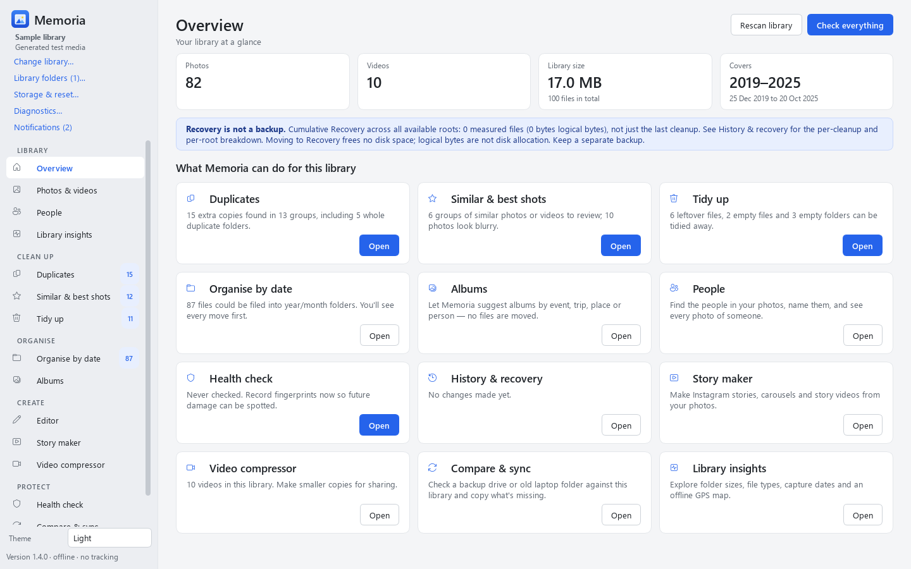
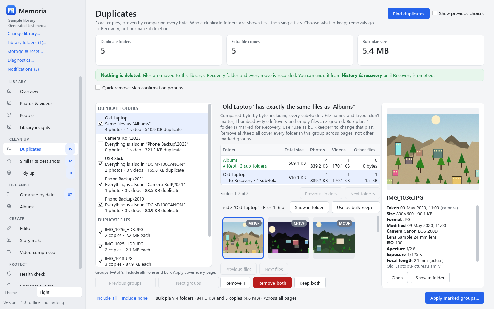
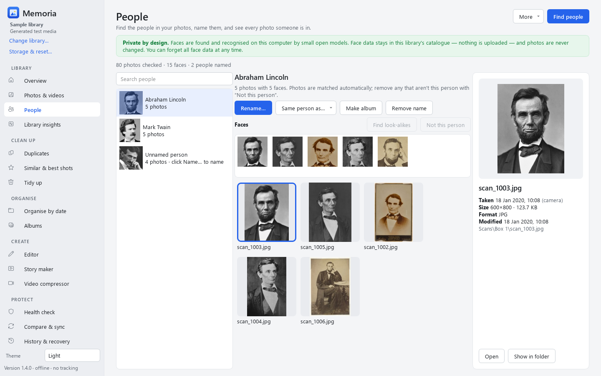
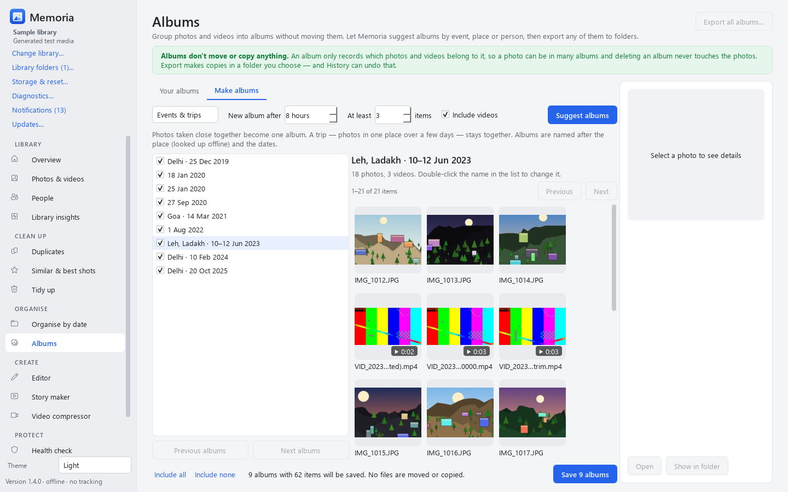
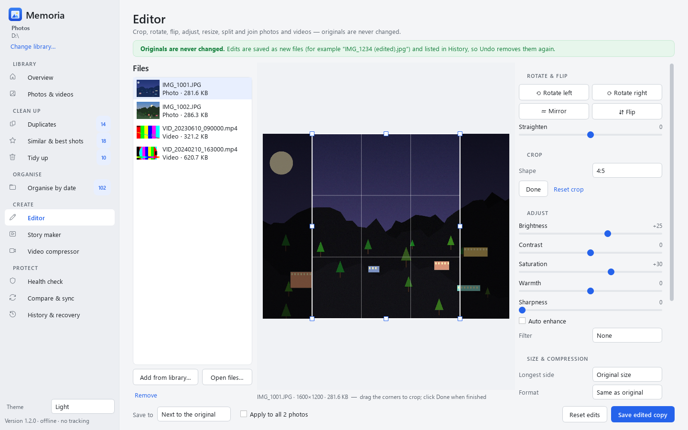
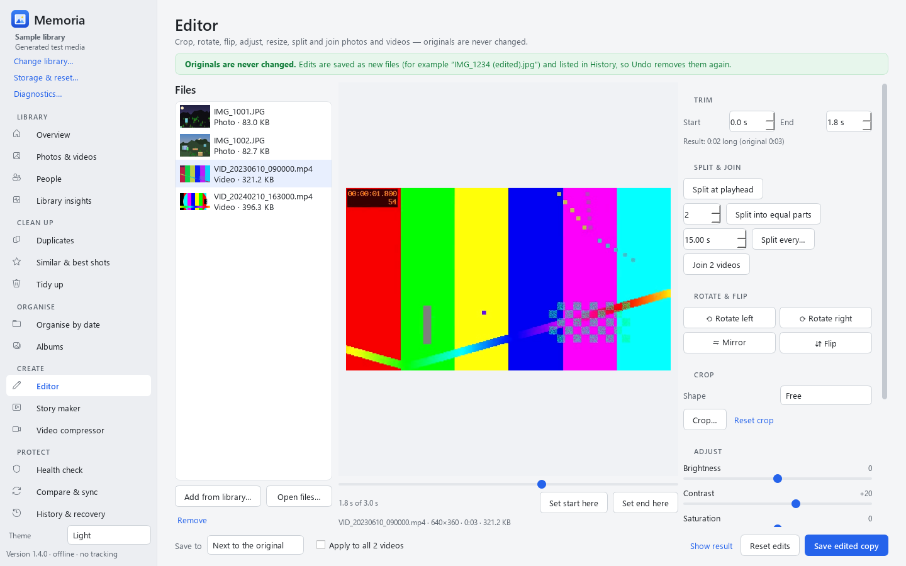
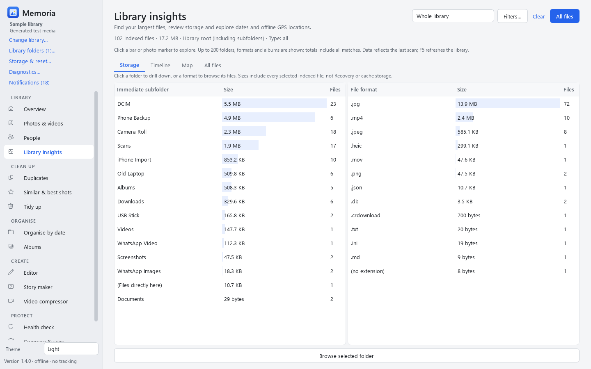
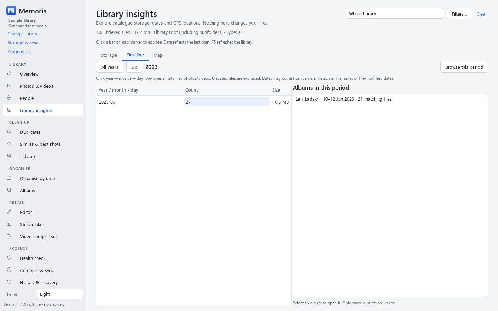
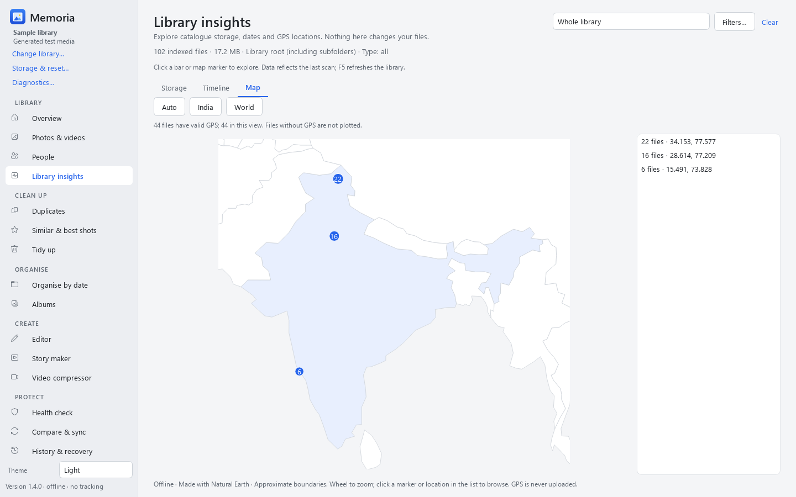
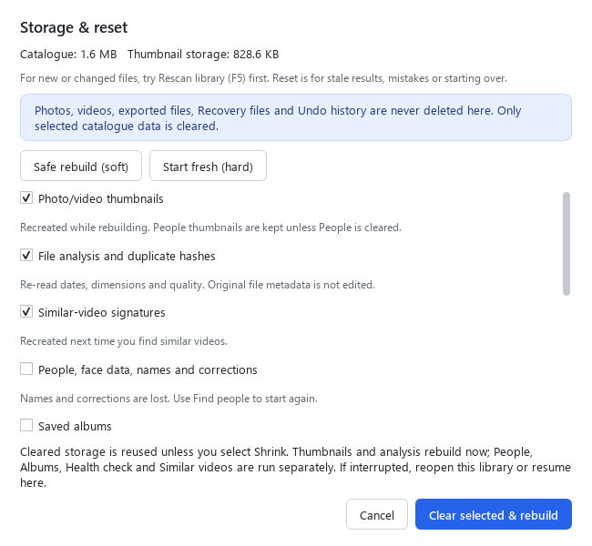

# Memoria — photo & video manager

A private, offline photo and video manager for Windows, built to be easy to trust.

Memoria looks after a personal photo library:
- finds exact duplicates — including whole duplicate folders — and look-alike shots, and picks the best photo of a burst;
- clears junk files and files photos into date folders;
- recognises the people in your photos — offline — so you can name them and see every photo of someone;
- makes albums automatically from events, trips, places and people, and exports them to folders;
- detects silent file damage and compares the library with a backup;
- makes Instagram stories and story videos, and smaller copies of videos for sharing;
- charts folder/type storage, timelines and offline GPS locations, with filters and size sorting;
- offers safe/custom/hard catalogue reset with restartable rebuilding and optional storage compaction.

Clean-up changes are reviewed before they happen and are undoable. **Removed originals go to Recovery**
until you explicitly empty it. Undoing a copy or export removes the generated files only if their recorded
fingerprints still match.



| 📘 [Features guide](docs/features.html) | 🎨 [Design document](docs/design.html) | 🛠️ [Technical document](docs/technical.html) | ✅ [Quality report](docs/report.html) |
|---|---|---|---|

The documents are HTML files in [`docs/`](docs/index.html). Open them locally in a browser (GitHub shows HTML source, not
the rendered page).

---

## Contents

- [Highlights](#highlights)
- [Quick start](#quick-start)
- [The tools](#the-tools)
- [Why you can trust it](#why-you-can-trust-it)
- [Screenshots](#screenshots)
- [How it works](#how-it-works)
- [Repository layout](#repository-layout)
- [Testing & quality reports](#testing--quality-reports)
- [Local diagnostics](#local-diagnostics)
- [Building a standalone app](#building-a-standalone-app)
- [Performance](#performance)
- [Troubleshooting](#troubleshooting)
- [Roadmap](#roadmap)
- [Licence](#licence)

## Highlights

- **15 focused pages** replace the 20 commands of the old command-line tool, plus **Check everything**: one read-only
  pass that runs every finder and puts count badges in the sidebar.
- **Find → Review → Confirm → Apply → Undo** for file clean-up, with plain-language reasons for suggestions.
  Irreversible personal catalogue clearing has a separate acknowledgement.
- **Exact duplicates are proven**, not guessed: files are compared by full-content hash (xxh3-128), and the kept copy is
  verified before anything moves.
- **People**: finds faces with two small open models (YuNet + SFace, run by OpenCV), groups the same person
  together, and lets you name, join and correct groups, find look-alikes, and search Photos & videos by name. All
  offline; face data stays in the library's catalogue and can be forgotten with one click.
- **Albums** without moving files: suggested from events and trips ("Leh, Ladakh · 10–12 Jun 2023"), places (offline
  town names from GeoNames) or named people; edit them, add from Photos & videos, and export one or all albums to
  folders with verified, undoable copies.
- **Similar videos**: finds compressed, resized or trimmed copies by comparing frames, and keeps the best copy.
- **Batch actions** in Photos & videos: select many items, then move to Recovery, copy to a folder (verified), move
  within the library, compress, or send to the Story maker. All undoable.
- **Light, dark or Match Windows** themes, keyboard shortcuts, a built-in viewer, and thumbnail zoom.
- **Progress for long operations**: percentage, elapsed time and time left where available, with cooperative Cancel
  (Esc). Insights has a separate background loading indicator.
- **Key-event notifications**: desktop messages only while Memoria is backgrounded/minimised by default. Indexing,
  file operations, exports, warnings, health problems and cancellation are covered. **Notifications** in the sidebar
  offers per-device delivery/category settings and up to 50 recent events. Messages never include filenames or paths;
  existing Undo toasts remain. Windows may suppress desktop delivery; closing Memoria still exits.
- **Best-shot picker** for bursts and WhatsApp-style copies. It scores sharpness, exposure, faces and resolution, and
  shows the reasoning (e.g. "sharpest (20× the softest)").
- **Editor** for photos and videos: crop with aspect presets, rotate, mirror/flip, straighten, brightness, contrast,
  saturation, warmth, sharpness and filters, resize, compress, change format and remove GPS. For videos: trim, split,
  join, crop, rotate, adjust, change speed, mute and save a frame as a photo. Results are always new files, recorded
  in History.
- **Story maker**:
  - 1080×1920 stories in six layouts;
  - 4:5 or square carousels, including a seamless panorama split;
  - story videos with Ken Burns motion, crossfades and music.
- **Video compressor**:
  - quality presets, or a target size such as 16 MB for WhatsApp;
  - every copy must play, keep the same length and be smaller;
  - an SSIM quality score is reported.
- **Health check** fingerprints every file and flags silent damage, such as bit rot or bad copies.
- **Bounded browsing**: 500-row pages, a 64 MiB thumbnail pixel cache, bounded analysis submission and aggregated maps.
  Similarity is still quadratic; old random-hash microbenchmarks are not end-to-end photo-library timings.
- **Extended metadata**: sort/filter video length, resolution, estimated overall bitrate, FPS and codecs; photo ISO,
  aperture, exposure time, focal length and lens; plus camera, orientation, format and modified dates.
- **Live browsing during indexing:** completed entries appear periodically in Photos & videos. Search, filters,
  paging and the viewer work while indexing; utilities stay locked until indexing stops.
- **Tested** against generated libraries and synthetic catalogues, including UI tests in both themes and fake-tray
  tests for notification privacy, focus, cancellation and partial failures.

## Quick start

Requirements: Windows 10/11 and Python 3.11+ (3.12 recommended).

```powershell
git clone https://github.com/rishabhjain9196/memoria-photo-manager.git
cd memoria-photo-manager
.\run.ps1                    # first run creates .venv and installs dependencies, then starts the app
.\run.ps1 "D:\Photos"        # open a specific library
```

Other ways to start:

```powershell
.\.venv\Scripts\pythonw.exe Memoria.pyw          # no console window
.\.venv\Scripts\python -m memoria "D:\Photos"    # module entry point
pip install -e .[dev]; memoria                   # installs the 'memoria' GUI command (pyproject.toml)
```

No library handy? On the welcome screen choose **Try it on a sample library**. It generates a realistic library in
`%LOCALAPPDATA%\Memoria\Sample Library` with duplicates, bursts, junk, a damaged file and videos.

## The tools

| Page | What it does | What it changes |
|---|---|---|
| **Overview** | Totals, years covered, safety status, and what each tool would do for this library. | Nothing |
| **Photos & videos** | Timeline (year → month), search, filters, zoom, viewer and a large preview. The preview shows the date and where it came from, camera, GPS and problems. **Batch actions** on a selection. | Nothing, unless you run a batch action |
| **Library insights** | Interactive folder/file-format storage bars; year → month → day counts with saved-album links; an offline India-first/world GPS map. Click charts to browse matching files. | Nothing |
| **People** | Faces found offline and grouped by person. Name groups, join them, correct mistakes (*Not this person*), find look-alikes, hide strangers, make an album. Names are searchable in Photos & videos. | Nothing (catalogue only) |
| **Duplicates** | Whole duplicate folders first (same files, or all inside a bigger folder), shown at the highest level with size, photo and video counts and sizes; then byte-identical single copies. Memoria explains which copy or folder it keeps; you can choose another or exclude any. | Moves copies or whole folders to Recovery |
| **Similar & best shots** | Bursts, retakes and resized copies, with an explained best pick. The *Similar videos* tab finds re-encoded and trimmed copies. A *Blurry photos* tab has three sensitivities, and nothing is pre-ticked. | Moves ticked items to Recovery |
| **Tidy up** | Thumbs.db, desktop.ini, .DS_Store, `._` files, partial downloads, empty files and folders. Unreadable media and stray documents start unticked. | Moves files to Recovery; removes empty folders (undo recreates them) |
| **Organise by date** | Moves files into `2024\2024-07`-style folders using the camera date, then a date in the file name. Files dated only by modified time are skipped unless you opt in. | Moves files inside the library |
| **Albums** | Albums suggested by events and trips, places or people; rename, add, remove, set cover. Export one or all albums to folders. | Nothing — export writes verified copies (undoable) |
| **Editor** | Crop, rotate, flip, straighten, adjust, filter, resize, compress, split and join photos; trim, split, join, crop, rotate, adjust, change speed and mute videos. Live preview, batch apply. | Writes new files (never changes originals); undoable |
| **Story maker** | Instagram stories, carousels and story videos with a live preview. | Writes new files to an output folder |
| **Video compressor** | Smaller copies of videos for sharing, using presets or a target size, with verification and a quality score. | Writes new files to an output folder |
| **Health check** | Records a fingerprint of every file, then flags *possibly damaged*, *can't be opened* and *missing* files on later checks. | Nothing (catalogue only) |
| **Compare & sync** | Compares the library with a backup by content, so renamed copies still match. Copies what's missing in either direction. | Writes verified copies |
| **History & recovery** | File-operation batches and steps; Undo; open or empty Recovery. | Undo may remove unchanged generated copies; Empty Recovery permanently deletes originals stored there |

The [Features guide](docs/features.html) explains every option, including the sidebar's **Storage & reset** controls.
These documents describe unreleased source updates after 1.4; an existing packaged executable must be rebuilt to include them.

## Why you can trust it

| Promise | How it is enforced |
|---|---|
| Looking preserves originals | Scanning, analysis, comparison and health checks read media and update `.memoria`. Opt-in diagnostics additionally writes aggregate reports in the source checkout. |
| Review clean-up first | The shared file-plan confirmation states what will happen, with counts and sizes. Creative tools have explicit Save/Export controls. |
| Originals are protected | "Remove" moves files to `.memoria\recovery\<batch>\<original path>`. **Empty Recovery** permanently deletes them and requires acknowledgement. Undo can delete unchanged generated copies. |
| File operations are recoverable | Moves, copies and published outputs are journaled for Undo. Empty Recovery and acknowledged deletion of personal catalogue data cannot be undone. |
| No stale decisions | Just before acting, each file's size and modified time are re-checked. Duplicates are also re-hashed, and the kept copy is verified. Changed files are skipped and reported. |
| Nothing is overwritten | Name clashes get a new name, such as `IMG_1234 (2).jpg`. |
| Copies are proven | Each copy is written to a temporary name, compared byte for byte, then renamed. |
| One window per library | A lock file prevents two Memoria windows (or processes) from changing the same library. |
| Unreadable is not deleted | A scan aborts on an inaccessible root; unreadable files/folders retain entries. For interrupted operations, check History for completed steps. |
| Undo retains catalogue knowledge | Recycled rows are retained and restored, except metadata you deliberately clear with reset. IDs are not reused for new imports. |
| Interrupted work is reconciled | Pending operations and reset phases are checked on reopening. This is not repair for arbitrary database or drive corruption. |
| Private | No account, no network calls, no telemetry. |

## Screenshots

| Duplicates | Similar & best shots |
|---|---|
|  |  |
| **People** | **Albums** |
|  |  |
| **Editor (photo)** | **Editor (video)** |
|  |  |
| **Story maker** | **Video compressor** |
|  |  |
| **Similar videos** | **Dark theme** |
|  |  |
| **Organise by date** | **History & recovery** |
|  |  |
| **Storage insights** | **Timeline and albums** |
|  |  |
| **Offline GPS map** | **Storage reset** |
|  |  |

## How it works

```
memoria.ui  (PySide6, main thread)  ── pages ──► Page.run(...)  /  Page.apply_actions(...)
                                                   │                    │ confirm dialog
                                                   ▼                    ▼
                                       TaskRunner (one background task at a time, progress + cancel)
                                                   │
memoria.engine (no Qt)  scanner · duplicates · similar · organize · tidy · health · compare · story · videotools
                                                   │  reviewed file plans are Actions
                                                   ▼
                                       actions.apply  ─ preflight ─ journal ─ recycle/move/copy/rmdir ─ undo
                                                   │
                        library folder  +  .memoria\ (memoria.db · thumbs.db · recovery\)
```

- **Indexing:** an incremental `os.scandir` walk, then parallel analysis. JPEGs are decoded at reduced resolution; the
  analysis reads EXIF date/camera/GPS and orientation, makes a 256 px thumbnail and a 64-bit dHash, and measures
  sharpness and exposure at a fixed 512 px. Results are written to SQLite (WAL) in batches.
- **Duplicates:** files are grouped by size, then checked with a sampled hash, then a full hash. Files with a unique size
  are never read.
- **Similar:** multi-threaded, vectorised Hamming distance on dHashes. Bursts come from a capture-time sliding window.
  Byte-identical copies are collapsed, faces are detected lazily, and each group gets an explained ranking.
- **Video:** FFmpeg (bundled through `imageio-ffmpeg`), libx264 using CRF or two-pass encoding, then verification and
  SSIM.
- **Stories:** Pillow composition; OpenCV warps for Ken Burns frames, piped to FFmpeg.
- **Published outputs:** Editor, Story and Video workers use `created_batch`; shared publication records a fingerprint
  and pending operation before renaming, so completed items remain journaled after cancellation.
- **Insights:** parameterised SQL filters/aggregates, 500-row pages and a bounded GPS grid drawn with offline Natural Earth data.
- **Reset:** transactional selected-data clearing, then durable cache, optional compaction and incremental rebuild phases.

Details, schema and algorithms are in the [Technical document](docs/technical.html).

## Repository layout

```
memoria-photo-manager/
├── memoria/                    application package
│   ├── engine/                 UI-independent engine (testable without Qt)
│   │   ├── actions.py          journaled executor: apply · undo · reconcile · Recovery
│   │   ├── db.py               Library + schema v6 (files, extended metadata, journal, retained rows, reset state)
│   │   ├── catalogue.py · geography.py · storage.py  filters/aggregates, offline map, selective reset
│   │   ├── diagnostics.py      allowlisted aggregate reports and bounded performance metrics
│   │   ├── scanner.py          incremental scan + parallel analysis
│   │   ├── media.py · ffmpeg.py · hashing.py · config.py · progress.py
│   │   ├── duplicates.py · similar.py · videosim.py · organize.py · tidy.py · health.py · compare.py
│   │   ├── faces.py · albums.py · places.py
│   │   ├── data/               face models + licences · GeoNames places · Natural Earth map + credits
│   │   └── batch.py · checkup.py · photoedit.py · videoedit.py · story.py · videotools.py
│   ├── ui/                     PySide6 desktop app
│   │   ├── app.py · main_window.py · tasks.py · widgets.py · theme.py · assets/
│   │   ├── insight_charts.py · library_filters.py · storage_dialog.py
│   │   ├── diagnostics.py      per-device/library consent, preview and local report recording
│   │   └── pages/              one module per sidebar page (+ base.py)
│   ├── samplelib.py            generator for the sample / test library (with expected.json)
│   ├── sample_faces/           public-domain portraits used by the sample library (CREDITS.txt)
│   └── __main__.py             python -m memoria
├── tests/                      pytest suite (engine ground truth, story, video, UI end-to-end)
├── tools/                      make_test_library · ui_screenshots · benchmark · make_reports · make_icon · verify_build
├── docs/                       index · design · features · technical · report (HTML) + images/
├── Memoria.pyw                 windowed launcher
├── run.ps1 · build.ps1         start (sets up .venv) · build standalone app
├── pyproject.toml · requirements.txt
├── CHANGELOG.md · LICENSE · README.md
└── .gitignore · .gitattributes
```

These are generated and not committed: `.venv/`, `dist/`, `build/`, `test-library/`, `__pycache__/` and any
`.memoria/` folders.

## Testing & quality reports

```powershell
.\.venv\Scripts\python -m pytest -q                       # 209 tests; runtime depends on the machine
.\.venv\Scripts\python tools\make_reports.py              # tests + benchmark → docs\report.html
.\.venv\Scripts\python tools\make_reports.py --no-bench   # tests only
.\.venv\Scripts\python tools\make_reports.py --no-bench --refresh-images # report + documentation screenshots
```

| Suite | Tests | Proves |
|---|---|---|
| `tests/test_engine.py` | 29 | Results match ground truth: duplicates (including files over 1.28 MB), bursts and best frame, near-duplicates, blur, dates and their sources, rotation, HEIC, video, tidy, organise. Safety: changed files are skipped, nothing is overwritten, copies are verified, undo restores an identical tree, crash reconciliation, cancellation, Empty Recovery. |
| `tests/test_faces.py` | 8 | Expected people are grouped, changed photos re-scanned, missing-photo metadata retained, names/corrections survive regrouping, look-alike search, Undo keeps faces, forget all. |
| `tests/test_albums.py` | 7 | Offline place names, event and trip albums, place and people albums, album edits never touch files, export + undo. |
| `tests/test_dupfolders.py` | 6 | Duplicate folders: nested copies shown once at the top, contained and renamed folders, folder sizes and counts, clean-up and undo restore the exact tree, changed or new files keep their folder. |
| `tests/test_photoedit.py` | 20 | Photo edits: exact rotate/flip/crop, straighten, adjustments, formats, EXIF and GPS handling, split and join, cancellation. |
| `tests/test_videoedit.py` | 12 | Video edits: trim, speed, rotate, crop, mute, split, join, frame export, cancellation. |
| `tests/test_safety.py` | 21 | Unavailable drives, unreadable files/folders, stable identities, retained missing files, verified Undo, failed Recovery deletion, crash recovery, output publication, schema migrations, paths over 260 characters. |
| `tests/test_videosim.py` | 7 | Similar videos match ground truth, signature cache, cancellation, undo. |
| `tests/test_batch.py` | 5 | Batch copy, move and recycle with undo; Check everything is read-only and correct. |
| `tests/test_video.py` | 7 | Compression shrinks and verifies, sources are untouched, target size is met, cancel cleans up. |
| `tests/test_story.py` | 30 | Exact output sizes, every template, panorama seams, EXIF rotation, story-video duration. |
| `tests/test_ui_smoke.py` | 4 | Drives every page in both themes; checks Undo, thumbnails, opt-in cleanup, reset confirmations and the resumable reset UI. |
| `tests/test_storage.py` | 13 | Safe/custom/hard reset, retained media and Undo, atomic rollback, abrupt process exit, cancellation/retry, updated media and low-space compaction. |
| `tests/test_insights.py` | 6 | Folder/type totals, literal search, combined filters, leap-day boundaries, album links, India/world GPS selection, bounded 10,000-file browsing and interactive charts in both themes. |
| `tests/test_metadata.py` | 21 | Real EXIF/video extraction, schema-5 backfill, retained-row migration, cancellation/resume, numeric sorting with unknowns last, combined metadata filters and preview UI. |
| `tests/test_diagnostics.py` | 9 | Cached-only summaries, sensitive-field exclusion, opt-in and bounded metrics, real Windows memory counters, atomic writes, task timing and library-switch/disable safety. |
| `tests/test_live_index.py` | 4 | Completed pictures visible before indexing finishes, stable selected previews, locked utilities/context menus, timed commits, cancellation/resume and thumbnail invalidation. |

The **test library** (`tools\make_test_library.py [DEST] [--small]`) is a deterministic library of generated photos. It
includes camera, phone and backup folders; exact duplicates (including 6 MB files); a nested album copied whole to an old
laptop folder and a USB stick holding some camera photos; 5-frame bursts with a known best
frame; WhatsApp-style copies; blurry shots; EXIF-rotated portraits; HEIC; screenshots and other files dated only by file
name; public-domain portraits of three historical figures for People; junk; empty files and folders; a truncated JPEG; documents; and videos. Its `expected.json` lists what every tool
should find.

UI screenshots for review or docs:

```powershell
$env:MEMORIA_SHOT_LABEL = "<b>Photos</b><br>D:\"     # optional: hide the real library path in images
.\.venv\Scripts\python tools\ui_screenshots.py <library-copy> <out-dir>
```

## Building a standalone app

```powershell
.\build.ps1        # → dist\Memoria\Memoria.exe (PyInstaller, windowed, about 340 MB including the face models)
.\tools\verify_build.ps1    # runs the packaged exe on a generated library and checks the result
```

The build bundles the icon, FFmpeg and OpenCV data. It then removes parts the app never loads (OpenCV's video-capture
FFmpeg, Qt's software OpenGL, Qt Quick/QML/PDF and unused face models), which takes it from 420 MB to 338 MB. The `.exe` is unsigned, so Windows
SmartScreen warns the first time it runs.

## Local diagnostics

Open **Diagnostics** in the sidebar and enable recording for the current library on that device.
This works with an **already-scanned catalogue**: diagnostics does not reset or rescan media. Past timings cannot
be reconstructed; future tasks, browsing and previews are measured. You can enable it while an initial scan is
running to include that task when it finishes.

When running from a source checkout, aggregate JSON reports are saved under
`diagnostics\reports\report-<random>.json`, automatically after main tasks, roughly once a minute, and on normal exit.
Each library/recording session gets a separate report. Consent is local application settings, not a tracked repo file.
No automatic staging, commits, uploads or deletion occur.

Reports contain counts/bytes, allowlisted format/codec distributions, coarse technical-metadata bins, coverage,
error categories, journal status counts, timings and basic system/process-memory information. They exclude media,
filenames/paths, capture dates, GPS coordinates, camera/person/album names, face embeddings and file-content hashes.
CPU/memory cover the app process, not FFmpeg children; per-operation CPU deltas can overlap with background/UI work.
Browsing/preview timings accumulate between snapshots to avoid a whole-catalogue query on every click.
Counts and system information are not guaranteed anonymous.

**Turn recording off, review the JSON, then stage only reports you intend to share.** Do not add the catalogue or
raw logs to git. See [diagnostics/README.md](diagnostics/README.md) for precise contents and sharing commands.
Old reports remain after disabling recording or resetting a library; interrupted writes keep the previous complete
snapshot. A packaged installation without a source checkout cannot record repository-local reports.

## Performance

### Libraries around 200-300 GB

Indexing reads originals in place; it does not make a second copy of the library. It does need
space for the catalogue and thumbnails. Analysis has a bounded queue of pending jobs, and the
decoded thumbnail cache has a 64 MiB pixel-data budget (Qt overhead is additional).
File count, image dimensions, codecs and drive speed matter more than total GB.

Copying, editing and video exports still require free space for their outputs and temporary files.
Recovery generally moves files on the same drive; it is **not a backup** and does not free disk space
until you explicitly empty it.

The test suite exercises a 10,000-entry catalogue representing 300 GB using synthetic analysis,
without creating 300 GB of files. It also checks dense similarity matches and failure recovery.
These checks do not replace real-drive throughput or long-video testing. Similarity comparisons
remain quadratic; very large collections can still take time.

### Browse while indexing

You do not have to wait for the full library to finish. Open **Photos & videos** while indexing:
completed catalogue entries are available for filtering, sorting, paging and viewing. New analysis is
committed at 200 results or approximately one-second intervals; the view checks for updates every two seconds.
Unprocessed entries are not shown as blank photo tiles. Previously analysed cached entries remain browsable
even if their extended metadata is being refreshed.

The banner shows how many photos/videos are ready and how many still need analysis/metadata. While you have
a selection, are scrolled down, or are on a later page, the view is held so it does not jump. **Update view**
loads the latest results, clears selection and returns to page 1. Search/sort/page changes are still available.

Cleanup, moving/copying, editing, album changes and other utilities remain disabled during active indexing.
After a normal cancel, committed results are kept; F5 resumes unfinished work. Progress is based on file count,
not equal work per file, so a later video-heavy portion can take longer than the earlier photo portion.
To update a running installation, let indexing finish or cancel normally, close the app, pull the update and
restart. Do not reset/delete the catalogue to install this change.

### Safety and review

- Copy Undo verifies the recorded output fingerprint. Older copies with no recorded fingerprint are
  left in place for manual review rather than deleted.
- Missing files remain listed in Health check across rescans. Their metadata and identities are
  retained and restored if they return at the same path; files in disconnected folders are not treated
  as deleted.
- Comparisons stop with an error when the backup cannot be completely read.
- Similar-photo/video suggestions start **unticked**. Review them, then select what to move; the
  explicit "Keep only best in every group" shortcut remains available.
- Editor, Story maker and Video compressor outputs are recorded in History when a library is open,
  including completed outputs kept after cancellation.
- Opening an older catalogue upgrades it to schema v6. The upgraded catalogue requires this version
  or newer; keep a backup of the catalogue before upgrading if you need to return to an older release.
- Unified multi-folder libraries are not included in this update.

### Storage & reset

Use **Storage & reset** below the library name in the sidebar. For normal additions or changes to your
photos, try **Rescan library (F5)** first.

- **Safe rebuild (soft)** is the default: clear photo/video thumbnails, analysis and similarity caches,
  then re-index originals in place. Saved albums, people/names/corrections, health fingerprints,
  missing-file records, Recovery and Undo history remain.
- **Custom reset:** tick only the categories you want to clear. Clearing People, Albums, Health
  fingerprints or missing-file records requires acknowledgement and **cannot be undone**.
  Forgetting missing records also removes their album/face links.
- **Start fresh (hard)** selects all these categories. It resets the catalogue's user data and analysis,
  not your media or operating-system settings. Stable file identities and the operation journal are
  retained to keep Recovery and Undo usable. It does not delete the database folder.
- Thumbnails and file analysis rebuild immediately. Run **Find people**, album suggestions,
  **Health check**, or **Find similar videos** separately if you cleared their data. Clearing a health
  baseline loses the reference needed to detect older damage.
- **Shrink storage files** is optional. Otherwise cleared database pages are reused, but the allocated
  files may not get smaller. Shrinking needs temporary disk space; it never duplicates your media.

Reset selections are committed transactionally before cache clearing. If the app is killed, cancelled,
or the laptop shuts down, the next open resumes the unfinished phases instead of clearing data again.
Other library actions are paused while a reset is unfinished. Use **Resume rebuild** to retry; if disk
space is low, choose **Skip shrinking storage files**. Cancellation pauses work; it does not restore
personal catalogue data you already approved clearing.

Photos, videos, exported copies, Recovery files and Undo history are never deleted by these controls.
Reset is not a backup or a repair for physical drive damage or an unreadable/corrupt SQLite catalogue.
Keep the `.memoria` folder for recovery if the catalogue cannot be opened; deleting it would also delete
Recovery and history.

### Library insights and finding large files

Open **Library insights** in the sidebar (or Overview):

- **Storage:** pick a folder; bars show its immediate subfolders, files directly in that folder, and
  file-format sizes/counts. Click a subfolder to drill down, or a format to browse its files.
  Totals come from the catalogue, exclude Recovery/cache storage, and count each indexed file once.
- **Timeline:** click a year, then a month, then a day to open matching photos/videos. Use **Browse this
  period** for the selected year/month. Saved albums containing matching files are linked beside the
  chart. These are capture dates where available, otherwise filename/modified dates; undated files
  are excluded from the chart.
- **Map:** bundled Natural Earth outlines keep GPS entirely offline. Auto starts with India for Indian
  coverage (or an empty map), switching to the world when coordinates fall outside the approximate India
  outline. India/World buttons override the viewport; the mouse wheel zooms. Markers cluster locations
  into a bounded grid. Click a marker or its keyboard-accessible list entry to browse those coordinates.
  Invalid/missing GPS is excluded. Borders are approximate; this is not authoritative country geocoding.

In **Photos & videos**, choose **Largest first** to find the biggest photos/videos. Filters combine
folder/subfolders, photo/video/other/problem type, file format, inclusive date range, minimum/maximum
MiB, GPS availability or a selected map area, detected faces and named people. Use **Find people**
first for face/person filters. Filename/folder/camera/person search is literal text.

Browsing uses pages of up to **500 files**, with matching count and total size shown. **Ctrl+A and batch
actions apply only to the current page**, not unseen matches. Clear filters to leave a chart's selection.
Insights queries run in the background and coalesce rapid requests; neither charts nor sorting re-read
the media contents. Results describe the last scan; use F5 after external file changes.

### Extended metadata

The sort menu now includes video length, pixel resolution, estimated overall Mbps, reported FPS, video/audio
codec, camera, lens, file format, modified date, ISO, f-number, shutter/exposure time and focal length.
Numeric sorts offer both directions. Unknown/inapplicable values sort last; they are not treated as zero.
Resolution compares width × height, so portrait and landscape videos with equal pixel counts tie.

**Filters** has three tabs: Files & dates, Dimensions & video, and Camera & exposure. Use inclusive numeric
ranges, minimum width/height, displayed orientation, exact camera/lens and codec selections. Video ranges match
videos; EXIF ranges match photos. Missing fields are excluded only when you constrain that field.
The preview shows the metadata and the grid caption follows the selected sort.

Schema v6 triggers a **one-time, resumable media-analysis refresh** to populate FPS/codecs and standard EXIF
ISO, f-number, exposure seconds, actual focal length (not 35 mm equivalent), and lens model where present.
Existing originals, identities, albums, people, journal and health fingerprints are retained.
Old parked/missing rows refresh when restored. The refresh reads originals in place and does not copy the library.

Bitrate is **estimated overall average Mbps = file bytes × 8 ÷ duration ÷ 1,000,000**, including audio/container
overhead; it is not the video stream's bitrate or a quality score. Reported FPS may describe variable-frame-rate
material approximately. Invalid optional EXIF numbers are logged and omitted rather than making up values.

### FFmpeg and HandBrake

Memoria currently compresses with its bundled **FFmpeg → libx264 (CPU H.264) + AAC** pipeline:
CRF quality presets or two-pass target-size encoding, output verification, optional SSIM and journaled publication.
HandBrake is a transcoding application, not a separate codec. It offers x264, x265, SVT-AV1 and hardware encoders
depending on the platform/build ([official encoder list](https://handbrake.fr/docs/en/latest/technical/video-codecs.html)).
HandBrakeCLI could be integrated, but has not been added; switching applications alone does not guarantee better
compression when both use x264. Codec/preset/hardware choices and compatibility matter more.

**Historical results, not rerun for this update:** `tools\benchmark.py --photos 1000`, 1,050 files of 6 MP JPEG,
1.02 GB, on a 32-core machine with an SSD. The 100,000-hash result is a random-hash microbenchmark, not a full photo search.

| Stage | Result |
|---|---|
| First index (EXIF, thumbnails, dHash, quality) | 5.9 s — about 178 photos/s, about 172 MB/s |
| Rescan, nothing changed | 0.01 s |
| Exact duplicates (first run / cached) | 0.14 s / 0.01 s |
| Similar photos, including face detection for group members | 5.6 s |
| Health check (full read of every byte) | 3.5 s — about 290 MB/s |
| Similarity pairs, 100,000 hashes | about 4.2 s |
| Similar-video signatures | about 0.15 s per short clip, then cached |
| Find people (sample library, 127 photos) | about 5 s, then only new photos |
| Story video, 1080×1920, with Ken Burns | about 96 fps |

## Troubleshooting

| Problem | Fix |
|---|---|
| `run.ps1` is blocked | `Set-ExecutionPolicy -Scope CurrentUser RemoteSigned`, or run `powershell -ExecutionPolicy Bypass -File run.ps1` |
| A photo wasn't organised | Its only date was the file's modified date. Tick *Also move files whose only date is the file's modified date*. |
| A sharp photo is listed as blurry | Smooth scenes (sky, fog, night) have little fine detail. Use *Only very blurry*; nothing there is ticked for you. |
| The library has a `.memoria` folder | It holds catalogue data, History and Recovery. Do not delete it to reset the app; use Storage & reset. Preserve it for recovery if it cannot be opened. |
| Results look stale or a rebuild stopped | Try F5; use Storage & reset for selective clearing. Resume an unfinished rebuild, optionally skipping shrinking when disk space is low. |
| Offscreen screenshots show boxes instead of text | Set `QT_QPA_FONTDIR=C:\Windows\Fonts` (the screenshot tool does this automatically). |
| "This library is already open" | Another Memoria window has it open. Close that window first. |
| "The library folder can't be reached" | The drive was unplugged or the network is down. Reconnect it and press F5. Nothing was changed. |
| OpenCV 5 is installed | Memoria needs `opencv-python-headless<5`, because OpenCV 5 removed the bundled face detector. |

## Roadmap

- Tune blur and best-shot scoring on real libraries.
- Screen-reader names for grid items.
- Unified multi-folder/offline-drive catalogue; screenshot text search (local OCR).
- Backup restore drill: restore a sample from a backup and prove it matches.
- Optional Rust (PyO3) hot paths if profiling shows a need.

See also the [CHANGELOG](CHANGELOG.md).

## Licence

Proprietary — © 2026 Rishabh Jain. All rights reserved. See [LICENSE](LICENSE). Third-party dependencies keep their own
licences; see the [Technical document](docs/technical.html#deps). Bundled data: YuNet face detector (MIT) and SFace
face recogniser (Apache 2.0) from the OpenCV model zoo; town names from [GeoNames](https://www.geonames.org) (CC BY 4.0);
public-domain test portraits from Wikimedia Commons (`memoria/sample_faces/CREDITS.txt`); public-domain country
outlines from [Natural Earth](https://www.naturalearthdata.com), with source and transformation details in
[world-map-CREDITS.txt](memoria/engine/data/world-map-CREDITS.txt).
